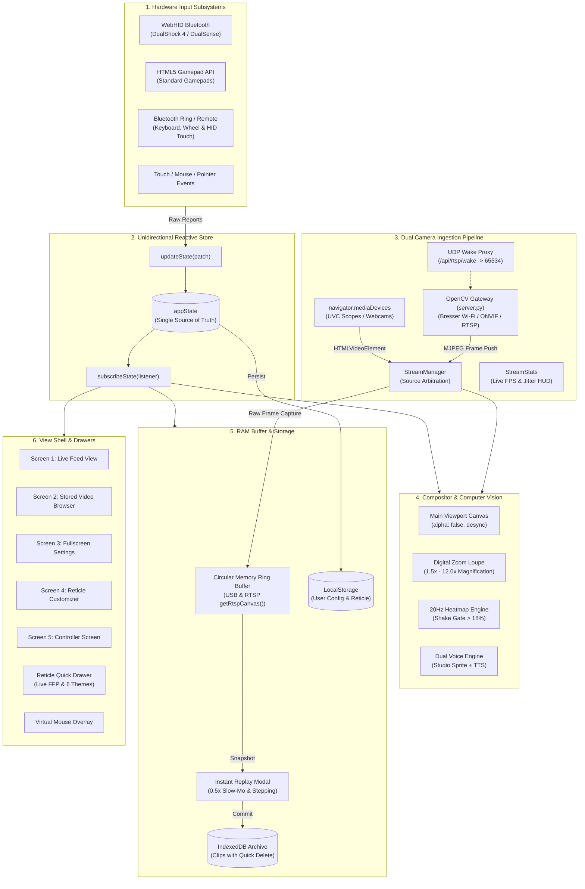
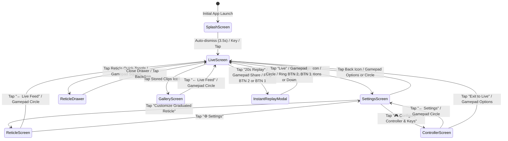

# SPOTR Software Architecture Document (v0.1.1)

## 1. Executive Overview

**SPOTR** (*Recon • Detect • Alert • Optical Precision*) is an ultra-low latency, driverless, offline-first Progressive Web Application (PWA) with a high-throughput Python 3 RTSP streaming gateway. It is engineered for tactical camera stream analysis, optical target pinpointing, hardware-assisted reticle calibration, micro-motion detection, directional voice callouts, and rolling circular memory video buffering.

```
+---------------------------------------------------------------------------------------------------------+
|                                             SPOTR PWA                                                   |
|                     (Pure Browser-Native ES2022 • Zero NPM Runtime Dependencies • 60 FPS)               |
+---------------------------------------------------------------------------------------------------------+
       │                                     │                                    │
       ▼                                     ▼                                    ▼
+──────────────────────────+       +───────────────────────────────────+       +──────────────────────────+
| Hardware HID & Inputs    |       | Dual Camera Ingestion Pipeline    |       | Dual Voice Synthesizer   |
| • WebHID (DualShock 4/5) |       | • UVC USB (1080p/4K Scopes)       |       | • Web Audio Studio Voice |
| • Capacitive Virt. Mouse |       | • RTSP Gateway (server.py OpenCV) |       | • Browser Web Speech API |
| • HTML5 Gamepad API      |       | • Bresser Wi-Fi Wake Proxy (UDP)  |       | • Directional Callouts   |
| • 7-Btn Bluetooth Ring   |       | • Sub-ms Condition Frame Push     |       | • Reticle Click Distance |
+──────────────────────────+       +───────────────────────────────────+       +──────────────────────────+
```

### Core Design Principles
1. **Zero External Runtime Dependencies**: Pure ES2022 modules running natively in modern Chromium-based browsers (Chrome, Edge, ChromeOS) paired with a lightweight, standalone Python 3 streaming gateway (`server.py`).
2. **Deterministic 60 FPS Graphics Pipeline**: Desynchronized 2D canvas contexts (`{ alpha: false, desynchronized: true }`), GPU hardware layer promotion (`translateZ(0)`, `contain: strict`), and `touch-action: none` gesture suppression for zero input latency.
3. **Dual Ingestion Video Architecture**: Seamlessly handles direct browser UVC USB cameras via `getUserMedia` as well as network IP/Wi-Fi RTSP cameras (e.g., Bresser Full HD Eyepiece Camera) via an asynchronous OpenCV FFmpeg bridge with sub-millisecond push-event frame distribution.
4. **Driverless Hardware Control**: Direct low-level USB/Bluetooth Human Interface Device (WebHID) access for DualShock 4/DualSense controllers, decoding raw capacitive touchpad packets into a hardware-accelerated Virtual Mouse with L2/R2 trigger integration.
5. **Decoupled 20Hz Computer Vision**: Micro-change heatmap runs on an independent 50ms interval with global camera-shake rejection (>18%) and dirty-checking to eliminate zero-op canvas redraws.
6. **Zero-Disk In-Memory Buffer**: Rolling circular RAM ring buffer storing up to 60 seconds of full-resolution JPEG frames from either USB or RTSP feeds with real-time budget guardrails.

---

## 2. High-Level System Architecture

The application is structured around a centralized reactive unidirectional state store (`state.js`) decoupling hardware input devices, dual-stream camera acquisition, computer vision analysis, canvas compositing, audio synthesis, and user interface rendering:



---

## 3. Subsystem Breakdown

### 3.1 Unidirectional State Store (`js/state.js`)
* **State Topology**: Holds all mutable application properties including viewport coordinates (`roiX`, `roiY`), digital zoom level (`mainZoom`), active camera source (`cameraSource`: `'usb'` | `'rtsp'`), RTSP endpoint configuration, reticle geometry (`reticleConfig`), First Focal Plane lock (`reticleFfpMode`), memory buffer telemetry, and controller bindings.
* **Reactivity**: `updateState(patch)` performs shallow property merges and dispatches updates to all registered listeners (`listeners.forEach()`).
* **Instant Mount Sync**: `subscribeState(fn)` executes the subscriber callback immediately with current state upon subscription to guarantee instantaneous UI synchronization.

### 3.2 Dual Camera Ingestion Pipeline (`js/camera/streamManager.js` & `server.py`)
* **UVC Camera Subsystem**:
  * Ingests local USB scopes and webcams via `navigator.mediaDevices.getUserMedia`.
  * Renders into hidden `<video id="cameraVideo">` at full sensor resolution (1080p, 4K).
  * Automatically switches to an animated synthetic test pattern card with calibrated hash lines if no camera is connected.
* **Network RTSP & Wi-Fi Gateway (`server.py`)**:
  * Employs an OpenCV (`cv2.VideoCapture`) FFmpeg worker thread capturing raw H.264/H.265 RTSP streams.
  * **Threading Condition Push Distribution**: Worker acquires frames and signals client threads via `threading.Condition(frame_lock).notify_all()`. Eliminates polling latency and delivers sub-millisecond MJPEG streaming to `/api/rtsp/stream`.
  * **Bresser Wi-Fi Eyepiece Camera Proxy**:
    * Proxies `/api/rtsp/wake` to send the required UDP magic wake packet (`b"bresser"`) to `192.168.1.1:65534`.
    * Supports Anyka DSP multi-channel streaming: Channel 0 (`rtsp://192.168.1.1:554/live/ch0`) for 1080p high-resolution optics, and Channel 1 (`rtsp://192.168.1.1:554/live/ch1`) for 540p high-framerate feed.
  * **Custom RTSP / ONVIF Endpoints**: Ingests arbitrary user-specified network RTSP URLs via simple UI configuration.
* **Live Telemetry Tracker (`streamStats.js` & `hudController.js`)**:
  * Measures rolling frame delivery times, computing instantaneous FPS, frame time jitter (ms), and native sensor resolution.

### 3.3 Dual-Canvas Compositor & Computer Vision (`js/renderer/compositor.js`)
* **GPU-Optimized 2D Viewport**:
  * Main Viewport Canvas rendered with `getContext('2d', { alpha: false, desynchronized: true })`.
  * Hardware promoted with `contain: strict; will-change: transform; transform: translateZ(0);` and `touch-action: none` to eliminate mobile browser gesture stalls.
  * Real-time CSS filter matrix (brightness, contrast, saturation, inversion, grayscale) with hardware acceleration.
* **Digital Zoom Loupe (PiP)**:
  * Dedicated picture-in-picture canvas displaying cropped region centered on normalized $(\text{roiX}, \text{roiY})$.
  * Interactive corner-resize handles and smooth sub-pixel interpolation.
* **Decoupled 20Hz Micro-Change Heatmap Engine**:
  * Runs on an independent 50ms timer (`setInterval`) decoupled from the 60fps render loop, eliminating frame drops.
  * Samples downscaled $160 \times 90$ luminance grid ($14,400$ cells) and computes pixel-wise delta $\Delta L = |L_t - L_{t-1}|$.
  * **Global Camera-Shake Gate**: If more than 18% of cells detect motion simultaneously, the frame is classified as camera vibration, wind buffeting, or panning, suppressing false alarms.
  * **Dirty-Checking State Machine**: When the scene is static or in full-frame shake, canvas operations are bypassed entirely, minimizing CPU and battery consumption.

### 3.4 Dual Voice Synthesizer Subsystem (`js/audio/voiceAudioEngine.js` & `voiceManifest.js`)
* **High-Fidelity Studio Voice Sprite Engine**:
  * Uses the browser Web Audio API (`AudioContext`, `AudioBufferSourceNode`, `GainNode`) playing pre-recorded studio female voice samples from `assets/audio/voice-sprite.mp3`.
  * Scheduled with sample-accurate playback offsets defined in `voiceManifest.js`.
  * Zero-delay vocalization: phrases are assembled dynamically (e.g. *"Detection"*, *"11 o'clock"*, *"3 clicks"*).
* **Browser Web Speech API Fallback**:
  * Seamlessly activates if Web Audio samples are unavailable or in environments lacking MP3 decode support.
  * Selects natural female voices with configurable pitch (1.25x) and speech rate (1.10x).

### 3.5 Parametric Reticle Engine (`js/renderer/overlayManager.js`)
* Dynamically generates scalable SVG graduated crosshairs with:
  * **First Focal Plane (FFP) Scaling Mode**: Locks reticle subtensions to the optical digital zoom (`scaleFactor = (overlayScale / 100) * (reticleFfpMode ? mainZoom : 1.0)`), maintaining angular mil/MOA accuracy across all zoom steps.
  * **6 Tactical Color Themes**: Cyan (`#2dd4bf`), Amber (`#ffd166`), Emerald (`#10b981`), High-Vis White (`#f8fafc`), Red (`#f87171`), Blue (`#60a5fa`) driven by dynamic HSL CSS custom properties.
  * **4 Center Aiming Symbols**:
    * `empty`: Clean, unobstructed center window.
    * `dot`: Sharp center aiming dot precisely at $(0, 0)$.
    * `cross`: Ultra-fine center mini-crosshair meeting at the true optical intersection.
    * `chevron`: Tactical inverted-V caret ($\land$) whose sharp apex points directly to the center measurement datum.
  * Configurable click count (2 to 30 per arm), SVG click pixel spacing (8px to 100px), center gap (0px to 140px), major tick intervals with numerical labels, and concentric range rings.
  * Optical turret click adjustments and voice callouts are computed strictly from true optical dead-center $(0, 0)$.

### 3.6 In-Memory Circular Video Buffer (`js/recorder/memoryRingBuffer.js`)
* **Dual-Source Ingestion**: Automatically reads full-resolution frames from `<video id="cameraVideo">` in UVC mode, or from the offscreen canvas helper `getRtspCanvas()` in RTSP mode.
* **Zero-Disk In-Memory Queue**: Rolling ring of binary JPEG ArrayBuffers in RAM (5s to 60s @ 5 to 30 FPS). Eliminates solid-state drive wear and thermal throttling on mobile tablets.
* **Live Memory Budget Meter**: Real-time RAM utilization tracking via `performance.memory` and budget estimation (`USED` vs. `EST` vs. `FREE MB`).
* **Instant Replay Modal (`instantReplay.js`)**:
  * Instant RAM snapshot playback with interactive scrubber.
  * **0.5x Slow-Motion Playback**: Dedicated slow-mo toggle for shot trajectory and bullet impact forensics.
  * **Single-Frame Stepping**: Dedicated `STEP -1` and `STEP +1` buttons for frame-by-frame analysis.
  * **Auto-Save**: Automatically commits replay clips into IndexedDB without interrupting live monitoring.

### 3.7 Stored Video Browser & Archive (`js/ui/videoBrowser.js` & `videoStore.js`)
* **IndexedDB Persistent Storage**: Stores recorded video clips with metadata (timestamp, resolution, duration, frame count).
* **Collapsible Clips Drawer with Quick Deletion**:
  * Displays thumbnail previews and recording timestamps.
  * **Per-Video Quick Delete**: Each clip card features a dedicated red trash icon (`.btn-quick-delete-clip`) allowing immediate deletion without opening the full replay player.
  * Clear All button for bulk archive management.
* **Standalone Fullscreen Player**:
  * Fullscreen review with play/pause, looping, scrubber, and 0.5x slow-motion.
  * **Native WebM Export**: Encodes stored frames into standalone `.webm` video files and triggers browser download.

### 3.8 Hardware Controller & Remote Subsystems (`js/input/gamepadController.js` & `ringController.js`)
* **DualShock 4 / DualSense WebHID Protocol**:
  * Scans for Sony Interactive Entertainment devices (`vendorId: 0x054c`).
  * Unlocks 78-byte telemetry report via initialization report `0x11` with hardware CRC32.
  * Decodes capacitive multi-touch trackpad bytes into a responsive Virtual Mouse cursor overlay.
  * **Left Trigger (`L2`)**: Left Mouse Click & Drag. Pulling L2 initiates pointer down / drag; releasing commits click.
  * **Right Trigger (`R2`)**: Dispatches right-click (`button: 2`, `contextmenu`).
* **Dual Thumbstick Tuning**:
  * **Hardware Deadzone**: Threshold of `0.16` completely eliminates resting analog stick drift.
  * **Non-Linear Aiming Curve**: $v_{out} = \text{sign}(v) \cdot |v|^{1.8}$ reduces low-deflection speed by 50–70% for sub-millimeter tick precision.
  * **Zero-Allocation Polling**: Gamepad loop uses cached object references to avoid garbage collection pauses.
* **Bluetooth Ring & Remote (`ringController.js`, 7-Button Schematic)**:
  * Supports wireless finger rings and compact remotes emitting HID keyboard/multimedia keys, mouse scroll wheel ticks, aux mouse clicks, or ChromeOS HID touch swipes/taps (e.g., Yiser-J6).
  * **Single 1-to-1 Direct Live Mode**:
    * `UP` / `DOWN` / `LEFT` / `RIGHT`: Pans the zoomed Live viewport (`mainZoom > 1.0x`, without auto-zooming from `1.0x`) at configurable speed (`ringPanSpeed`, 10%–150%, **70% default**).
    * `CENTER`: Cycles digital zoom presets (`1.0x → 1.5x → 2.0x → 2.5x → 3.0x → 1.0x`) and re-centers pan when returning to `1.0x`.
    * `BTN 2` *(Recommended on ChromeOS)* & `BTN 1`: Toggles Instant Replay In/Out.
  * **Automatic Player Override**: While Instant Replay or Gallery playback is active, `CENTER` toggles Play/Pause, `LEFT`/`RIGHT` step `-1`/`+1` frames, `UP` restarts Replay, and `DOWN`/`BTN 2`/`BTN 1` return to Live.
  * **HID Touch Calibration & ChromeOS Telemetry (`controllerScreen.js`)**: Classifies directional swipes (`≥12px` within `420ms` as `SwipeUp/Down/Left/Right`), distinguishes fixed-coordinate HID button taps via 5%-quantized `TouchTap@qxXqy` zones (`10%` nearest-match tolerance with `'TouchTap'` fallback), locks the remote schematic (`pointer-events: none`) during Learn capture, streams live `RAW:` telemetry, and guards `#pipZoomWindow` (`zoomWindow.js`) against held ring swipes (`> 420ms`).

---

## 4. Screen State Transition Topology



---

## 5. Security & Privacy Model

* **100% Client-Side Processing**: All video ingestion, computer vision diffing, speech synthesis, and video storage occur locally on the host device. No telemetry, audio, or video data is transmitted to external servers.
* **Local RTSP Gateway Boundary**: The Python gateway (`server.py`) binds strictly to the local network interface, translating local camera streams into MJPEG without external cloud intermediaries.
* **Camera Privacy**: Operates under standard browser camera permissions (`getUserMedia`).
* **WebHID Device Isolation**: Hardware access is explicitly granted per device through Chrome's native security picker prompt.
* **Offline-First PWA Pre-Caching**: All application assets, scripts, stylesheets, audio sprites, and vector icons are cached by Service Worker (`spotr-v0.1.1`) using Cache-First with background Stale-While-Revalidate updates, `skipWaiting()`, and automatic `controllerchange` page reload (`main.js`). Active builds display `APP_VERSION` (`v0.1.1`) in Setup header `.setup-version-badge` pills.
