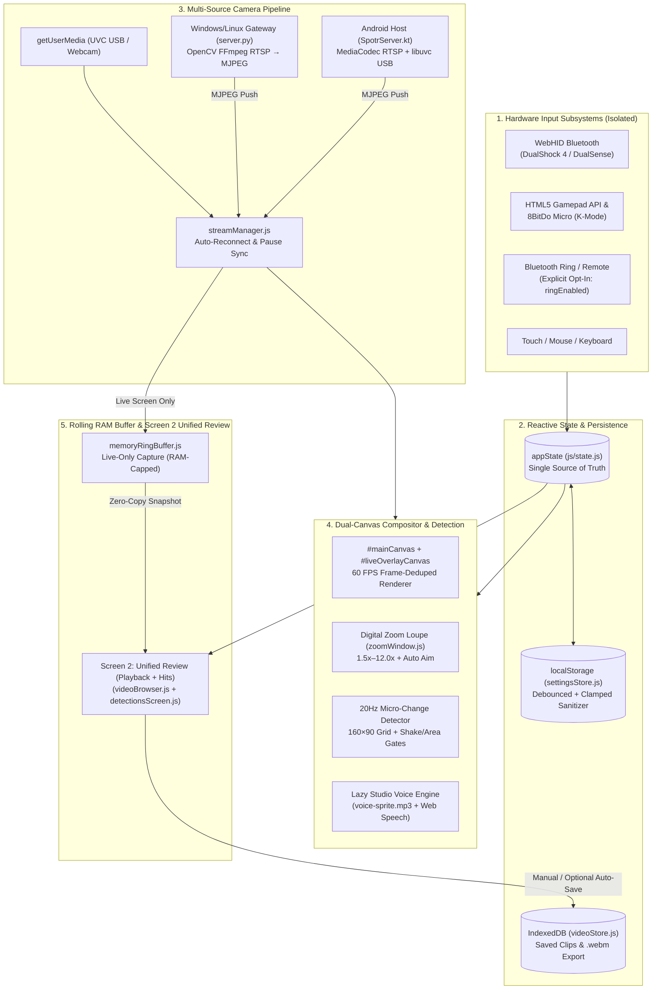
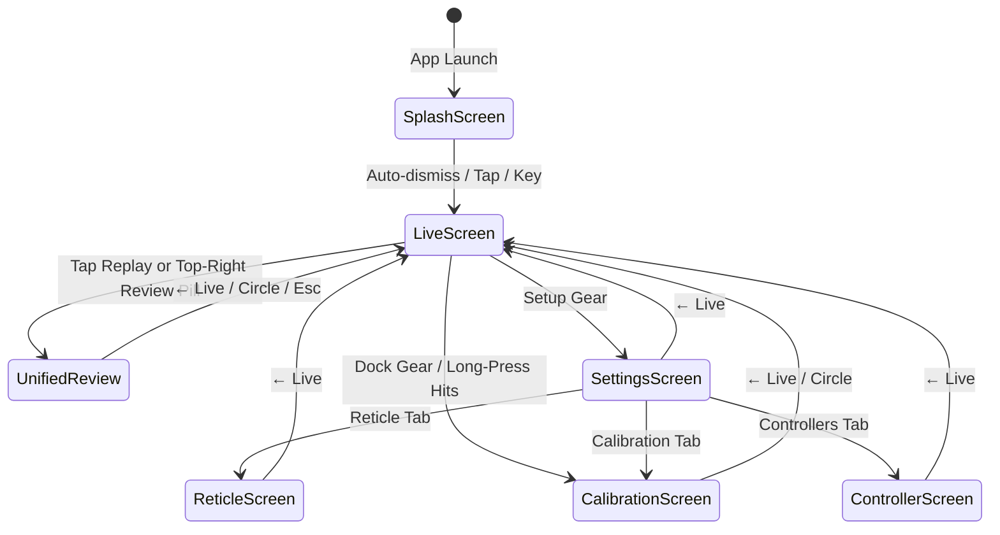

# SPOTR Software Architecture Document (v0.63.1)

> **Repository Note:** This repository (`EagleVision`) hosts **SPOTR** (*Recon • Detect • Alert • Optical Precision*). All former specification notes from `docs/project_plan.txt` have been consolidated here as the single technical source of truth.

---

## 1. Executive Overview

**SPOTR** is a zero-dependency, offline-first Progressive Web Application (PWA) paired with:
- A local Python 3 + OpenCV RTSP gateway (`platforms/windows/server.py`, with root proxy `server.py`), and
- A native Android & ChromeOS APK host (`platforms/android`, `com.spotr.tactical`, `versionCode 66` / `v0.63.1`) featuring an embedded NanoHTTPD server (`SpotrServer.kt`), native RTSP + `MediaCodec` H.264/H.265/MJPEG decoding, and native USB UVC capture via `libuvc`.

Target hardware ranges from **low-power tablets** (e.g., **Lenovo IdeaPad Duet 3** 4 GB RAM, ARM SoCs) to rugged Android phones and desktop/laptop systems. Every subsystem is engineered for **field reliability**, **battery conservation**, and **zero cloud dependency**.

---

## 2. High-Level System Architecture

---

## 3. 6-Screen Navigation Topology

| Screen | Container ID | Primary Purpose | Background Pipeline State |
| :--- | :--- | :--- | :--- |
| **1. Live** | `#screenLive` | 60 FPS scope viewport, FFP reticle, PiP loupe, translucent glass bottom dock (`Hits \| 🗑 \| ⚙`), icon-only Setup & Clean View, simplified `Review` pill | Compositor active, RAM buffer active (if enabled), RTSP/UVC active |
| **2. Unified Review** | `#screenGallery` | Consolidated `LIVE BUFFER (RAM)` + saved clips (`0.5x` slow-mo, `-1/+1` step, `.webm` export) & time-synced Spatial Hit Pins (`Pins: SYNC/ALL/OFF`, still-snapshot fallback for older hits, unified `Hits \| Clips` drawer) | Live compositor paused, RAM buffer paused, gateway JPEG encoding paused |
| **3. Setup** | `#screenSettings` | Camera sources (USB / Wi-Fi RTSP), Voice tuning, Display & Theme (6 swatches + custom picker, Display & Hit Timestamps) | Live compositor paused, RAM buffer paused, gateway paused |
| **4. Reticle** | `#screenReticle` | Parametric crosshair studio (FFP/SFP, 4 center styles, unified color theme swatches, custom image DataURL persistence) | Live compositor paused, RAM buffer paused, gateway paused |
| **5. Controllers** | `#screenController` | DualShock 4/5 WebHID, 8BitDo Micro K-Mode, isolated Bluetooth Ring toggle (`ringEnabled`, OFF by default), visual remap & JSON profile import/export | Live compositor paused, RAM buffer paused, gateway paused |
| **6. Calibration** | `#screenCalibration` | 1:1 thermal heatmap debug view, `✦ Auto-Tune`, noise-floor telemetry meter, Min/Max hit size, Ignore Zones, Shake Gate & Trail settings | Live camera & 20Hz heatmap active (hit logging suppressed), RAM buffer paused |

---

## 4. Gateway HTTP API Reference

Both the Windows/Desktop gateway (`platforms/windows/server.py`) and the Android embedded gateway (`SpotrServer.kt` on `127.0.0.1:8080`) expose the same local REST/MJPEG surface:

| Method | Endpoint | Platforms | Description |
| :--- | :--- | :--- | :--- |
| `GET` | `/api/rtsp/status` | Windows, Android | Returns gateway availability, OpenCV/MediaCodec backend info, active URL, FPS, resolution, and error status. |
| `GET` | `/api/rtsp/wake?ip=192.168.0.1&path=/app/getmediainfo` | Windows, Android | Local/private IP validated camera wake proxy (sends Bresser UDP magic packet on Android + HTTP `getmediainfo` probe) and returns `ch0`/`ch1` stream URLs. |
| `GET` | `/api/rtsp/stream?url=rtsp://...&transport=tcp` | Windows, Android | Streams low-latency `multipart/x-mixed-replace; boundary=frame` JPEG frames (validates `rtsp://` scheme and `tcp`/`udp` transport; client-refcounted). |
| `POST` | `/api/rtsp/pause?paused=1\|0` | Windows, Android | Pauses/resumes JPEG encoding (and skips H.264/H.265 P-frames on Android) while off Live/Calibration without tearing down the RTSP socket. |
| `POST` | `/api/rtsp/stop` | Windows, Android | Stops active RTSP capture session and releases camera socket. |
| `GET` | `/api/uvc/list` | Android (stub on Windows) | Lists attached USB UVC video devices (`deviceId`, label, VID:PID, permission status). Windows returns `{"supported": false, "cameras": []}`. |
| `GET` | `/api/uvc/status` | Android | Returns active USB UVC capture status, stage, FPS, and resolution. |
| `GET` | `/api/uvc/stream?deviceId=uvc:...` | Android | Streams native `libuvc` USB camera frames as multipart MJPEG. |
| `POST` | `/api/uvc/pause?paused=1\|0` | Android | Pauses/resumes USB UVC NV21→JPEG encoding. |
| `POST` | `/api/uvc/stop` | Android | Stops active USB UVC preview and releases camera handles cleanly. |

---

## 5. Slow-Hardware & Battery Optimizations (v0.63.1)

Designed specifically to keep **4 GB ARM/ChromeOS tablets** (such as the Lenovo IdeaPad Duet 3) cool, responsive, and OOM-free during multi-hour range sessions:

1. **Demand-Driven Render & Polling Loops:**
   - The 60–120 Hz compositor `requestAnimationFrame` loop pauses automatically when `document.hidden` or off Live/Calibration.
   - USB `<video>` canvas blits are deduplicated via `videoEl.currentTime` (zero redundant blits on 30 FPS cameras running on 60–120 Hz screens).
   - The `gamepadController.js` polling loop stops completely when no gamepad is connected or the tab is hidden.
   - The playback canvas loop stops whenever playback is paused or on the Hits tab.
   - The 20 Hz 14,400-cell thermal debug `putImageData` pass runs exclusively on Screen 6 Calibration.
2. **GPU-Composited Meters & Patch-Gated UI Sync:**
   - Memory and noise-floor meters animate via GPU `transform: scaleX()` instead of layout-thrashing `width`.
   - State subscribers gate DOM updates by changed keys, and Hits age timers update text/classes in place instead of rebuilding the Hits list every 5 seconds.
3. **Conservative Memory Guardrails:**
   - `voice-sprite.mp3` is decoded lazily only when Voice Callouts are enabled (saving 19–38 MB RAM on boot when muted).
   - `memoryRingBuffer.js` inspects `navigator.deviceMemory` and caps RAM allocation (`<= 220 MB` on 4 GB tablets) with generation-safe reset handling.
   - Leaving Screen 2 immediately frees `activeBufferClip` (releasing 50–300 MB of decoded frame references).
   - Detection thumbnails are downscaled to 640 px (`0.65` JPEG quality).
4. **Native Android & Windows Gateway Performance:**
   - **Android (`MediaCodecJpegDecoder.kt`):** Semi-planar NV21 bulk UV copy fast path (>70% NV21 conversion CPU reduction), skip-decode while paused with clean IDR resync on resume, automatic hardware-to-software decoder fallback for ChromeOS ARCVM, `FLAG_KEEP_SCREEN_ON`, low-latency `WifiLock`, and Android 10+ no-internet camera Wi-Fi network binding.
   - **Windows (`server.py`):** `disable_nagle_algorithm = True` + single coalesced frame write (eliminates 40–200 ms/frame Nagle+Delayed-ACK stalls), monotonic frame sequencing, and localhost-only binding by default (`--lan` opt-in for iOS/tablet LAN access).

---

## 6. Input Isolation Architecture

- **Bluetooth Ring Isolation (`appState.ringEnabled`, default `false`):** `ringController.js` ignores all HID key, wheel, and synthetic touch events unless the operator explicitly enables **BT Ring: ON** in **Setup → Controllers → Bluetooth Ring & Remote** (and automatically yields when the **8BitDo Micro** profile is active). This guarantees Bluetooth Rings never hijack 8BitDo Micro K-Mode or keyboard shortcuts.

---

## 7. Offline & Security Model

- **100% On-Device Processing:** Video capture, 20 Hz luminance diffing, voice audio sprites, timestamps, and IndexedDB clips stay completely local.
- **Service Worker (`core/sw.js`, `spotr-v0.63.1`):** Pre-caches all 40 core assets, bypasses all cross-origin requests (so camera wake probes to `http://192.168.0.1` are never intercepted or cached), and refreshes local assets safely via Stale-While-Revalidate without wiping active session hits.
- **Localhost & SSRF Hardening:** Both gateways validate `rtsp://` schemes, whitelist `tcp`/`udp` transport, restrict `/api/rtsp/wake` to private/link-local/loopback hosts, block directory listing and `..` path traversal, and bind `127.0.0.1` by default.
