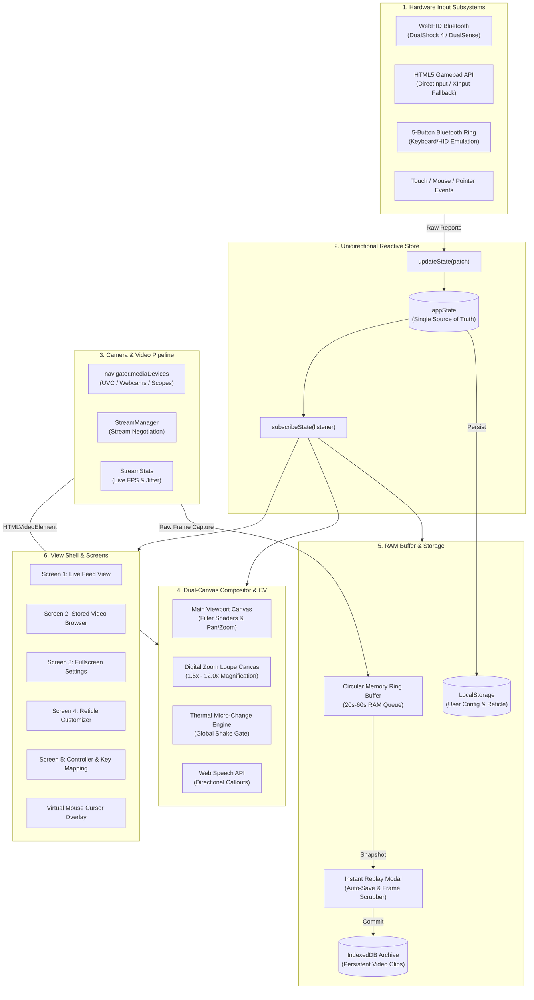
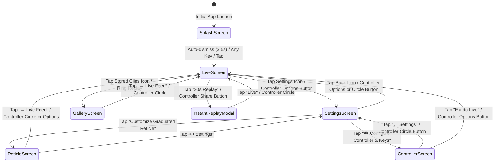

# SPOTR Software Architecture Document (Beta 1)

## 1. Executive Overview

**SPOTR** (*Recon • Detect • Alert*) is an ultra-low latency, driverless, offline-first Progressive Web Application (PWA) designed for tactical camera stream analysis, optical target pinpointing, hardware-assisted reticle calibration, micro-motion detection, and rolling circular memory video buffering.

```
+-----------------------------------------------------------------------------+
|                                SPOTR PWA                                    |
|   (Pure Browser-Native ES2022 • Zero NPM Runtime Dependencies • 60 FPS)     |
+-----------------------------------------------------------------------------+
       │                             │                              │
       ▼                             ▼                              ▼
+──────────────+              +──────────────+              +───────────────+
| Hardware HID |              | UVC Cameras  |              | Web Speech    |
| • WebHID BT  |              | • 1080p/4K   |              | • Local TTS   |
| • DualShock4 |              | • USB Scopes |              | • Callouts    |
| • 5-Btn Ring |              | • Webcams    |              | • Real-time   |
+──────────────+              +──────────────+              +───────────────+
```

### Design Principles
1. **Zero External Runtime Dependencies**: Pure ES2022 modules running natively in modern Chromium-based browsers (Chrome, Edge, ChromeOS).
2. **Deterministic 60 FPS Pipeline**: Double-buffered `requestAnimationFrame` composition separating input polling, thermal diffing, and canvas rendering.
3. **Driverless Hardware Control**: Direct low-level USB/Bluetooth Human Interface Device (WebHID) access for DualShock 4/DualSense controllers, decoding raw capacitive touchpad packets into a hardware-accelerated Virtual Mouse with L2/R2 trigger integration.
4. **Zero-Disk In-Memory Buffer**: Rolling circular RAM ring buffer storing up to 60 seconds of full-resolution JPEG frames with real-time budget guardrails.

---

## 2. High-Level System Architecture

The application is structured around a centralized reactive unidirectional state store (`state.js`) decoupling hardware input devices, camera acquisition, computer vision analysis, canvas compositing, and user interface rendering:



---

## 3. Subsystem Breakdown

### 3.1 Unidirectional State Store (`js/state.js`)
* **State Topology**: Plain JavaScript dictionary holding viewport coordinates (`roiX`, `roiY`), zoom parameters, filters, reticle geometry, memory buffer status, and controller telemetry.
* **Reactivity**: `updateState(patch)` shallow-merges properties and synchronizes all subscribed components via `listeners.forEach()`.
* **Instant Mount Sync**: `subscribeState(fn)` executes the subscriber callback immediately with the current state upon mounting to guarantee instant UI synchronization.

### 3.2 Hardware Controller Subsystem (`js/input/gamepadController.js`)
* **DualShock 4 Bluetooth WebHID Protocol**:
  * Scans for Sony Interactive Entertainment devices (`vendorId: 0x054c`, `productId: 0x05c4` / `0x09cc`).
  * Unlocks full 78-byte telemetry report by sending initialization output report `0x11` with hardware CRC32.
  * Decodes capacitive multi-touch trackpad bytes (2 contacts, 12-bit X/Y coordinates, touch timestamps, finger tracking IDs).
* **Virtual Mouse Engine**:
  * Trackpad finger velocity mapped through dynamic acceleration curve.
  * **Left Trigger (`L2`)**: Left Mouse Click & Drag. Pulling L2 initiates pointer down / drag at the virtual cursor coordinates; releasing L2 ends drag and commits clicks.
  * **Right Trigger (`R2`)**: Dispatches right-click (`button: 2`, `contextmenu`).
* **Dual Thumbstick Tuning**:
  * **Deadzone**: Hardware threshold of `0.16` eliminates resting analog stick drift.
  * **Aiming Curve**: Non-linear power curve $v_{out} = \text{sign}(v) \cdot |v|^{1.8}$ reduces low-deflection speed by 50–70% for sub-millimeter tick aiming.
  * **Reduced Maximum Speed**: Base ROI traverse speed reduced by 50% (`BASE_ROI_SPEED = 0.012` scaled by `reticleAimSpeed ?? 50%` $\to 0.006$ per frame) to prevent overshooting targets.
  * **Reticle Customizer Mode**:
    * Left Stick UP / DOWN: Cycles menu focus through drawer controls (`cycleFocus`).
    * Left Stick LEFT / RIGHT: Adjusts selected slider or toggle switch (`adjust`).
    * Right Stick X / Y: Directly sculpts Center Gap and Stroke Weight on the preview reticle.

### 3.3 Dual-Canvas Compositor & Computer Vision (`js/renderer/compositor.js`)
* **Primary Viewport**: Draws full-resolution camera frame with real-time CSS filter matrix (brightness, contrast, saturation, inversion, grayscale) and hardware-accelerated 2D transforms.
* **Digital Zoom Loupe (PiP)**:
  * Crop source bounding box centered at normalized $(\text{roiX}, \text{roiY})$.
  * Canvas-rendered with sub-pixel interpolation and reticle alignment.
* **Thermal Micro-Change Heatmap Engine**:
  * Samples consecutive camera frames at $160 \times 90$ grid resolution ($14,400$ cells).
  * Computes pixel-wise luminance differences $\Delta L = |L_t - L_{t-1}|$.
  * **Global Camera-Shake Gate**: If more than 18% of the scene changes simultaneously, motion is rejected as physical camera vibration or pan, suppressing false alarms.
  * Persistent decay overlay with adjustable duration ($1\text{s}$ to $\infty$).
* **Voice Speech Callout Synthesizer**:
  * Converts detection centroid coordinates into clock-face angle ($1$ to $12$ o'clock) and graduated reticle click distance.
  * Emits natural voice alerts: *"Detection! 11 o'clock, 3 clicks"* via local `SpeechSynthesisUtterance`.
  * Customizable alert and unit keywords via Settings.

### 3.4 In-Memory Circular Video Buffer (`js/recorder/memoryRingBuffer.js`)
* **Architecture**: Array of binary JPEG Blobs with timestamps maintained as a ring buffer in RAM.
* **Zero Disk Footprint**: Does not write to disk while monitoring, avoiding flash memory degradation on embedded tablets (ChromeOS / Android).
* **RAM Guardrails**: Computes browser heap budget via `performance.memory` (or fallback heuristics), displaying real-time memory usage and limiting buffer duration (5s to 60s).
* **Instant Replay**: Captures RAM buffer state, presents an instant replay scrubber bar, single-frame stepper buttons, 0.5x slow-motion playback, and auto-saves the clip to IndexedDB.

### 3.5 Parametric Reticle Engine (`js/renderer/overlayManager.js`)
* Dynamically constructs scalable SVG graduated crosshairs with:
  * **Extended Click Count**: Up to 30 clicks/indents per arm (2 to 30) on both vertical and horizontal axes for long-range elevation and BDC ladders.
  * **Optical Dead-Center Measurement**: Turret click adjustments and voice callouts are computed strictly from true optical dead-center $(0, 0)$, unaffected by center gap width.
  * **4 Selectable Center Aiming Symbols**:
    * `empty`: Clean, unobstructed open center gap.
    * `dot`: Sharp precision aiming dot centered at $(0, 0)$.
    * `cross`: Fine center mini-crosshair meeting at the exact dead-center intersection.
    * `chevron`: Tactical inverted-V caret ($\land$) whose sharp apex points directly to the exact center pixel from which click distances are measured.
  * Click distance in SVG/pixel spacing (8px to 100px with 1-pixel precision).
  * Center POI unobstructed gap (0px to 140px).
  * Inner alignment brackets and major tick intervals with numerical labels (every 5 or 10 clicks).
  * Concentric range circles corresponding directly to labeled click rings.

### 3.7 Controller & Key Mapping Subsystem (`js/ui/controllerScreen.js`)
* **Dedicated Fullscreen Configuration Matrix**: Provides visual representation of connected DualShock 4 / Gamepad with real-time input glowing and live action banner readout.
* **Flexible Rebinding Pipeline**: Supports interactive capturing of gamepad buttons, triggers, stick-clicks, and keyboard keys with conflict resolution and profile presets (*Default DualShock 4*, *Simplified Field Mode*, *Flight / Arcade Stick*).
* **Analog Fine-Tuning**: Real-time stick deadzone sliders (5% to 40%), Invert Y-Axis toggles for independent left/right thumbsticks, aim speed attenuation (10% to 100%), and capacitive touchpad sensitivity.
* **Cyclic Quick-Tool Selector**: Ergonomic cycling dock on the live feed (D-Pad ◀ / ▶) enabling instant toggling (Cross ✕) of secondary operational tools (*Heatmap Detection*, *Voice Announcements*, *Reticle Overlay*, *FFP Zoom Lock*, *PiP Loupe*, *Declutter Sight*, *Telemetry HUD*) without screen navigation.

### 3.8 First Focal Plane (FFP) Reticle Optical Engine (`js/renderer/overlayManager.js` & `compositor.js`)
* **Proportional Subtension Scaling**: Matches optical scope First Focal Plane mechanics by automatically scaling reticle markings and hashmark spacing in lockstep with whole-image digital zoom: `scaleFactor = (overlayScale / 100) * (reticleFfpMode ? mainZoom : 1.0)`.
* **Dynamic Click Distance Measurement**: Integrates FFP scaling directly into bullet impact / micro-motion distance computation (`getClickDistanceInPixels`), guaranteeing that angular measurements (mils/MOA) and directional voice announcements ("*3 clicks*", "*2 mils*") remain physically accurate across all magnification levels.
* **Rapid Joypad Subtension Spacing**: Dedicated D-Pad ▲ (widen +5%) and D-Pad ▼ (tighten −5%) adjustments with tactical on-screen display (OSD) HUD feedback for instant field calibration to known target distances.

---

## 4. Screen State Transition Diagram



---

## 5. Security & Privacy Model
* **100% Client-Side Execution**: All processing, video stream ingestion, computer vision diffing, speech synthesis, and video storage occur locally on the client device. No telemetry, audio, or video data is transmitted over external networks.
* **Camera Privacy**: Operates exclusively under standard browser camera permissions (`getUserMedia`).
* **WebHID Device Isolation**: Hardware access is explicitly granted per device through Chrome's native security picker prompt.
