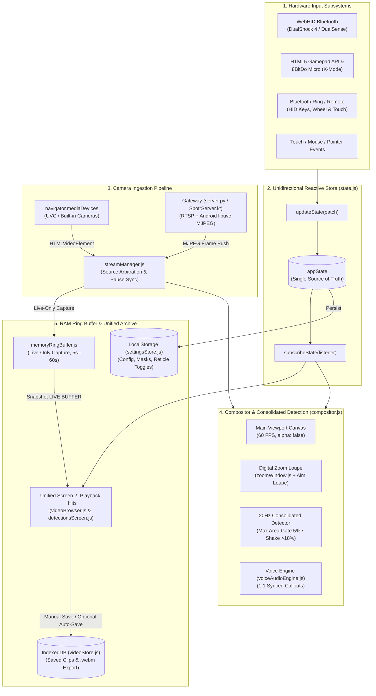
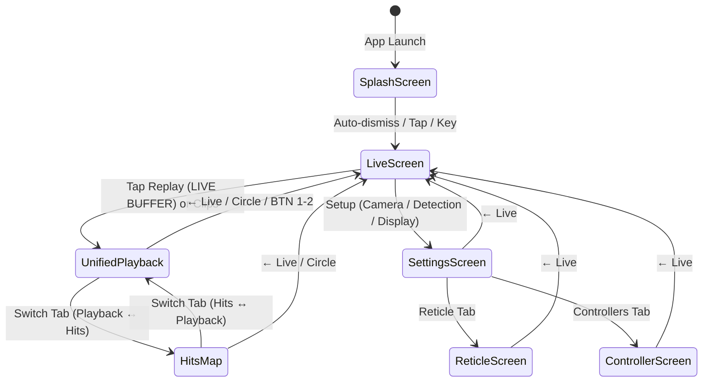

# SPOTR Software Architecture Document (v0.1.11)

## 1. Executive Overview

**SPOTR** (*Recon • Detect • Alert • Optical Precision*) is a driverless, offline-first Progressive Web Application (PWA) paired with a Python 3 RTSP gateway (`server.py`) and an embedded Android/ChromeOS host (`platforms/android`, `SpotrServer.kt`). It delivers 60 FPS digital magnification, First Focal Plane (FFP) graduated reticles, consolidated 20Hz micro-motion detection with 1:1 synced studio voice callouts, a rolling RAM ring buffer with unified Playback & Spatial Hits review, and WebHID/Bluetooth controller integration.

```
+---------------------------------------------------------------------------------------------------------+
|                                       SPOTR PWA / ANDROID SHELL                                         |
|                     (Pure Browser-Native ES2022 • Zero NPM Runtime Dependencies • 60 FPS)               |
+---------------------------------------------------------------------------------------------------------+
       │                                     │                                    │
       ▼                                     ▼                                    ▼
+──────────────────────────+       +───────────────────────────────────+       +──────────────────────────+
| Hardware HID & Inputs    |       | Multi-Source Ingestion Pipeline   |       | Consolidated CV & Voice  |
| • WebHID (DualShock 4/5) |       | • UVC USB (getUserMedia / libuvc) |       | • 20Hz 160×90 Luma Grid  |
| • 8BitDo Micro (K-Mode)  |       | • RTSP Gateway (OpenCV/MediaCodec)|       | • Max Area Gate (5% def) |
| • HTML5 Gamepad API      |       | • Bresser Wi-Fi Wake Proxy (UDP)  |       | • 1:1 Hit + Voice Sync   |
| • Bluetooth Ring/Remote  |       | • MJPEG Condition-Push Stream     |       | • Studio Audio Sprite    |
+──────────────────────────+       +───────────────────────────────────+       +──────────────────────────+
```

---

## 2. High-Level System Architecture



---

## 3. Subsystem Breakdown

### 3.1 Unidirectional State Store (`js/state.js` & `js/storage/settingsStore.js`)
- Holds camera source state, `mainZoom` / `mainPanX` / `mainPanY`, Digital Loupe coordinates (`roiX`, `roiY`), per-screen reticle toggles (`overlayEnabled` on Live, `playbackReticleEnabled` default `false`, `hitsReticleEnabled` default `true`), detection parameters (`heatmapSensitivity`, `heatmapDuration`, `heatmapMaxAreaPct` default `5%`, `heatmapMinCells` default `2`, `heatmapAutoSave` default `false`), ignore masks (`heatmapIgnoreMasks`), and session hits (`detectionHits`).

### 3.2 Camera Ingestion & Native Android Bridge (`js/camera/streamManager.js`, `server.py`, `platforms/android`)
- **Desktop/ChromeOS**: Captures UVC USB cameras via `getUserMedia`, or network RTSP/Bresser streams via `server.py` (OpenCV + `threading.Condition` MJPEG push + UDP wake proxy).
- **Android APK (`com.spotr.tactical`)**: `MainActivity.kt` hosts `SpotrServer.kt` (NanoHTTPD on `127.0.0.1:8080`), bridging both native RTSP (`RtspSessionManager.kt` + `MediaCodecJpegDecoder.kt`) and USB UVC cameras (`UsbUvcSessionManager.kt` via `libuvc`), including `/api/rtsp/pause` and `/api/uvc/pause` during Screen 2 review.

### 3.3 Compositor, Digital Loupe & Consolidated Detection (`js/renderer/compositor.js`, `zoomWindow.js`)
- **Digital Zoom Loupe (`zoomWindow.js`)**: Resizable/draggable PiP loupe (`1.5x–12.0x`) with `aimLoupeAtHit()` and `snapLoupeToLatestHit()`, accessible directly from the Live dock (`#btnLiveAimLoupe`) or controller binding.
- **Consolidated 20Hz Detection Pipeline (`updateHeatmap` → `handleConsolidatedDetection`)**:
  - Analyzes a `160×90` (`14,400`-cell) luminance grid while skipping cells inside `heatmapIgnoreMasks`.
  - Runs whenever `heatmapEnabled || heatmapSpeechEnabled` is active (drawing thermal overlays only when `heatmapEnabled` is true).
  - **Global Shake Gate**: Rejects and re-anchors background if `>18%` of unmasked cells change simultaneously.
  - **Multi-Hit / Area Gate**: Suppresses hit creation and alerts if changed or spiked cells exceed `heatmapMaxAreaPct` (default `5%` = `1/20th` of the screen) or fall below `heatmapMinCells` (default `2`).
  - **1:1 Synced Event Output**: Merges ongoing flickers within `1500ms` & `0.055` radius; every new confirmed hit atomically logs the pin to `detectionHits`, triggers the studio voice callout (`announceHitVoice`), records a single timeline marker (`recordEvent('heatmap')`), and optionally queues `triggerAutoSaveHeatmapClip()`.

### 3.4 Parametric Reticle Engine (`js/renderer/overlayManager.js`)
- `renderReticleOverlayLayer()` drives all three stages from a single SVG/custom-image builder (`buildGraduatedCrosshairSvg`):
  - **Live (`#overlayLayer`)**: Controlled by `overlayEnabled` (supports FFP lock with `mainZoom`).
  - **Playback (`#galleryReticleLayer`)**: Controlled by `playbackReticleEnabled` (**OFF by default**).
  - **Hits Map (`#hitsReticleLayer`)**: Controlled by `hitsReticleEnabled` (**ON by default**), scaled directly inside `#hitsTransformLayer`.
- `exportAnnotatedCanvasPng()` in `compositor.js` rasterizes the configured reticle (including resolved theme accent color or custom image) onto PNG snapshots for each screen according to that screen's reticle state.

### 3.5 RAM Ring Buffer & Unified Screen 2: Playback | Hits (`memoryRingBuffer.js`, `instantReplay.js`, `videoBrowser.js`, `detectionsScreen.js`)
- **Live-Only RAM Ring Buffer**: Captures frames only while `appState.currentScreen === 'live'`, automatically pausing when entering Playback, Hits, or Setup. `snapshotMemoryBuffer()` prunes frames older than `bufferMaxSeconds` before creating a snapshot.
- **Unified Playback (`videoBrowser.js`)**:
  - Pressing **Replay** opens Screen 2 (`Playback` tab) directly on the pinned **`LIVE BUFFER (RAM)`** source without auto-saving to IndexedDB; clicking **`Save Clip`** persists it on demand.
  - Supports `0.5x` slow-mo, `-1 / +1` frame stepping, CCTV waveform event scrubbing, `Reticle: OFF/ON`, PNG snapshot, `.webm` export, and per-clip deletion.
- **Spatial Hits Map (`detectionsScreen.js`)**:
  - Displays numbered pins (no popup text callouts) and minimal `#N / Total` navigation.
  - **`Hits: ON/OFF`** hides/shows pins so underlying target marks can be inspected.
  - **`👁 Masks (N)`** toggles visual mask visibility while keeping masking active; **`✎ Edit Masks`** enables drag-to-draw, per-mask `×` removal, and confirmed **`Clear All`**.
  - **`Re-Zero`** re-anchors the heatmap background and clears logged hits together.

---

## 4. Screen State Transition Topology



---

## 5. Offline & Security Model

- **100% Local Processing**: Video ingestion, motion diffing, voice sprite playback, and IndexedDB clip storage remain completely on-device.
- **Offline Service Worker (`sw.js`)**: Pre-caches all core assets (`spotr-v0.1.15`) and auto-reloads on version updates (`APP_VERSION` = `v0.1.11`).
